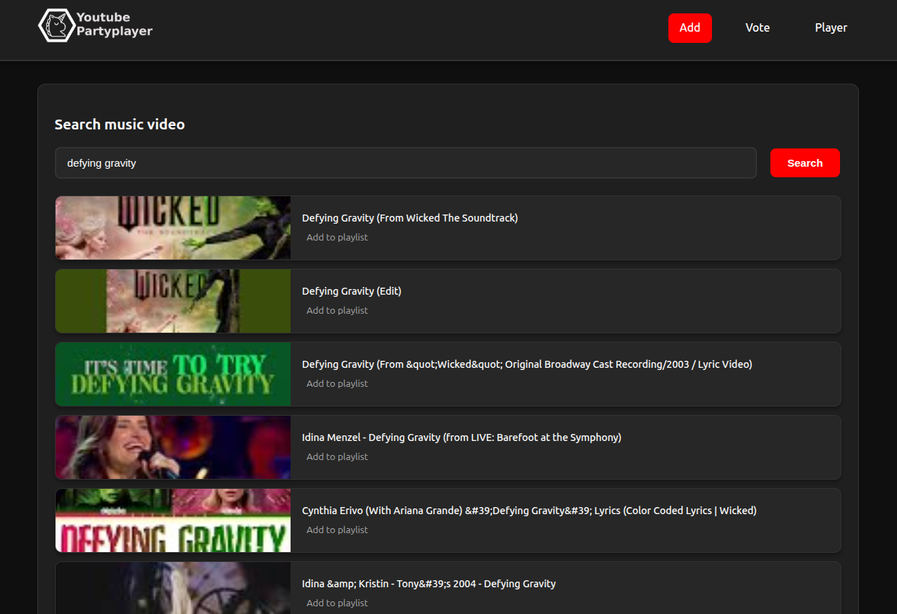
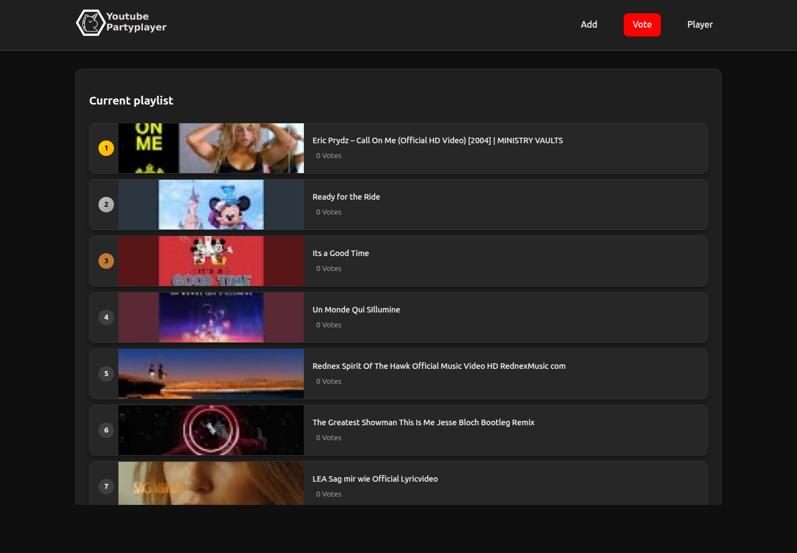
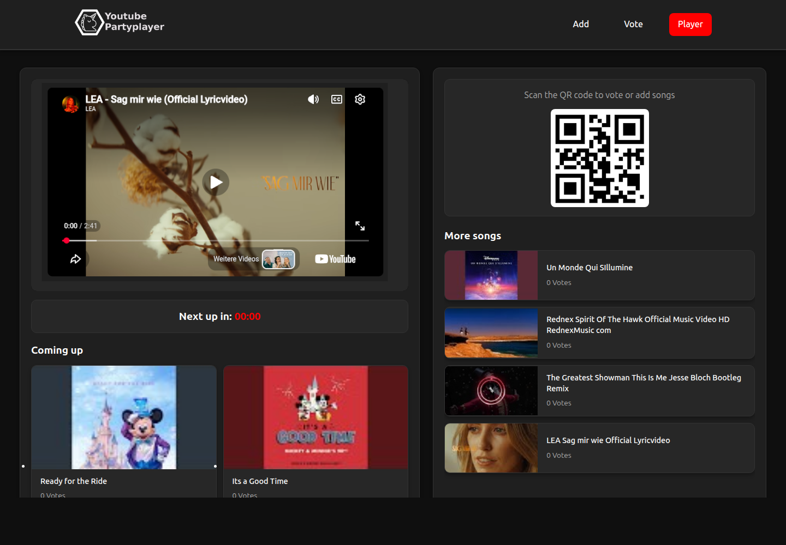

# YT Democracy Player

A PHP-based democratic YouTube music player. Visitors can add and vote for songs; the player automatically plays the highest-ranked songs.

## Features

- Add songs: Search YouTube via API and add to playlist
- Democratic voting: Vote for songs on vote.php
- Auto player: Plays the highest-ranked song and refreshes the queue
- Player display: Shows the next songs, vote counts, QR code, and playlist notifications
- Playlist management: Songs are sorted by votes and removed when played
- Localization: German for German-language browsers and English as the default for all other languages

## Screenshots

Screenshots of the add-song, voting, and player pages:

| Add songs | Vote on songs |
| --- | --- |
|  |  |

| Player and upcoming playlist |
| --- |
|  |

Playlist content on the live demo may differ from these example screenshots.

Application assets are grouped under `assets/` (CSS, JavaScript, images, fonts, and Sass sources); screenshots are stored in `docs/screenshots/`.

## Requirements

- PHP 7.2+
- Composer
- YouTube Data API v3 key

## Installation

1. Clone repo:
```bash
git clone <repo-url>
cd yt-democracy-player
```

2. Install dependencies:
```bash
composer install
```

3. Create config:
```bash
cp config/config.example.php config/config.php
```

4. Set your YouTube API key in `config/config.php`:
```php
define('YOUTUBE_API_KEY', 'YOUR_YOUTUBE_API_KEY_HERE');
```

5. Ensure the web server can write to the configured playlist file (default: `data/playlist.json`).

6. Start the development server:
```bash
php -S localhost:8000
```

## Usage

- `index.php` - add songs
- `vote.php` - vote for songs
- `player.php` - player view
- The player periodically refreshes the playlist and displays toast notifications when songs are added or the next top song changes.

## Configuration

Configuration in `config/config.php` (gitignored). See `config/config.example.php`.

- `YOUTUBE_API_KEY` - YouTube Data API v3 key
- `PLAYLIST_FILENAME` - playlist file path (default: `data/playlist.json`)

## Data Structure

`data/playlist.json`:
```json
[
  {
    "title": "Song title",
    "thumbnail": "Thumbnail URL",
    "id": "YouTube video ID",
    "votes": 0
  }
]
```

## Tech

PHP, JavaScript (jQuery), YouTube IFrame API, Google APIs Client Library for PHP, Bootstrap/Vizew template

## License

Original code written specifically for this project is licensed under the MIT License; see [LICENSE](LICENSE). You may use, modify, and redistribute that code by retaining its copyright and permission notice. The original project author is Hendrik Horn.

The MIT license does not relicense Vizew-derived template materials or third-party components and assets. Those remain subject to their own licenses and attribution requirements; see the notices included with the relevant files and dependencies. In particular, the Vizew template is licensed under CC BY 3.0 and requires attribution to Colorlib.
